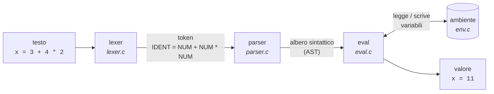
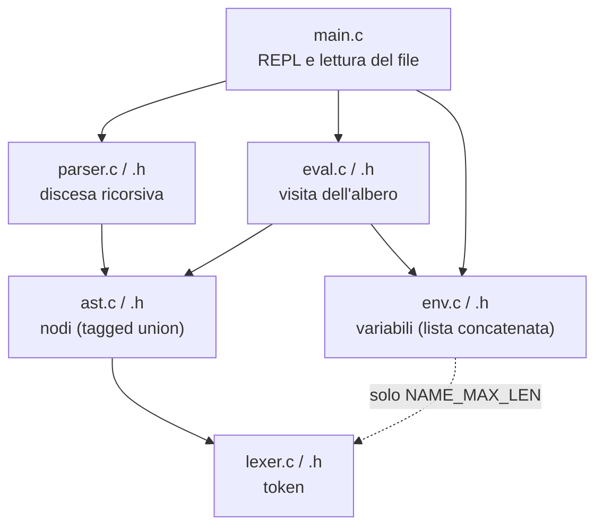
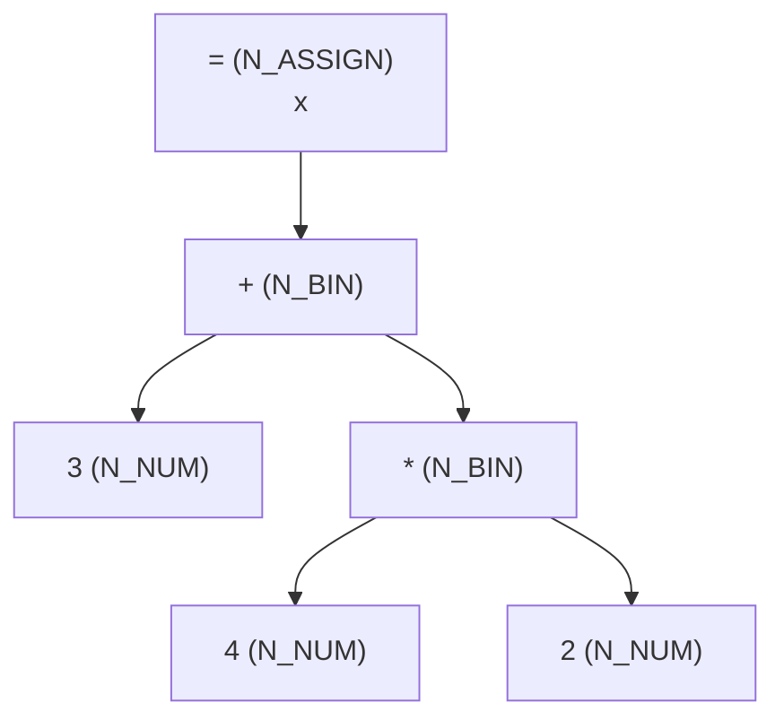

# calc — un micro-interprete in C

`calc` è un piccolo interprete di espressioni aritmetiche con variabili, scritto in C17 senza librerie esterne.
Legge una riga alla volta, dal terminale o da un file, e ne calcola il valore:

```text
> x = 3 + 4 * 2
x = 11
> -(x - 1) / 2
-5
> x = x / 2
x = 5.5
> x * (1 + y)
riga: errore: variabile 'y' non definita
```

È il progetto finale della serie sul linguaggio C del blog [giorgiodifusco.it](https://www.giorgiodifusco.it/blog)
(articolo *«Progetto in C: costruiamo un micro-interprete con lexer, parser ed eval»*), dove ogni modulo è spiegato riga per riga.
In circa seicento righe mette insieme quasi tutto quello che serve per scrivere un programma C vero:
più file con i loro header, un `Makefile`, `struct` e tagged union, liste concatenate, memoria dinamica senza perdite,
ricorsione e gestione degli errori.

## Cosa sa fare

- numeri decimali (`3`, `2.5`, `.75`) e le quattro operazioni `+ - * /`;
- precedenza degli operatori, parentesi e meno unario: `-(1 + 2) * 3` fa `-9`;
- variabili: `nome = espressione` crea o aggiorna una variabile, poi la si usa nelle righe successive;
- commenti con `#` fino a fine riga, righe vuote ignorate;
- messaggi d'errore con il numero di riga e una freccia sul punto sbagliato;
- modalità interattiva (REPL) oppure esecuzione di un file.

## Compilare ed eseguire

Serve un compilatore C17 (gcc o clang) e `make`.

```sh
make                     # compila ./calc
./calc                   # modalità interattiva: Ctrl-D per uscire
./calc esempi/esempio.calc
make test                # esegue gli esempi e confronta l'output con quello atteso
make debug               # ricompila con AddressSanitizer e UBSan (leak e accessi sbagliati)
make clean
```

Con [`esempi/esempio.calc`](esempi/esempio.calc):

```text
$ ./calc esempi/esempio.calc
base = 12
altezza = 7.5
area = 90
perimetro = 39
2.307692308
```

E con [`esempi/errori.calc`](esempi/errori.calc), che contiene un errore per riga (il codice d'uscita è 1):

```text
$ ./calc esempi/errori.calc
x = 10
riga 2: errore: divisione per zero
riga 3: errore: mi aspettavo un numero, una variabile o '('
  3 + * 4
      ^
riga 4: errore: manca la parentesi chiusa ')'
  (1 + 2
        ^
riga 5: errore: variabile 'z' non definita
```

Gli errori non fermano il programma: la riga sbagliata viene saltata e si passa alla successiva.

## Come funziona

Ogni riga attraversa tre fasi: il **lexer** la spezza in token, il **parser** costruisce l'albero sintattico,
l'**evaluator** lo visita e calcola il valore, leggendo e scrivendo le variabili nell'**ambiente**.



### I moduli

Sei moduli, ciascuno con il suo header. Le frecce sono gli `#include`: `main` non sa niente di token,
`eval` non sa niente di testo.



| Modulo | Responsabilità |
|---|---|
| [`lexer`](src/lexer.c) | spezza il testo in token (`T_NUM`, `T_IDENT`, operatori, parentesi, `T_END`) e ricorda la colonna di ciascuno |
| [`parser`](src/parser.c) | una funzione per regola della grammatica; costruisce l'albero o restituisce il primo errore con la sua posizione |
| [`ast`](src/ast.c) | il tipo `Node` (una tagged union) e `node_free`, che libera ricorsivamente un sotto-albero |
| [`eval`](src/eval.c) | calcola il valore di un albero; segnala divisione per zero e variabili non definite |
| [`env`](src/env.c) | le variabili definite finora, in una lista concatenata; il tipo `Env` è opaco |
| [`main`](src/main.c) | legge le righe (terminale o file), stampa risultati ed errori, decide il codice d'uscita |

### La grammatica

```text
riga     := IDENT '=' expr  |  expr
expr     := term    (('+' | '-') term)*
term     := unario  (('*' | '/') unario)*
unario   := '-' unario  |  primario
primario := NUMERO  |  IDENT  |  '(' expr ')'
```

Ogni regola diventa una funzione C (`parse_expr`, `parse_term`, …). La precedenza non è scritta da nessuna parte:
nasce dalla profondità delle chiamate. `term` sta più in basso di `expr`, quindi `*` e `/` vengono raccolti
prima di `+` e `-`. Ecco l'albero di `x = 3 + 4 * 2`:



La moltiplicazione è più in profondità della somma, quindi l'evaluator la calcola per prima: `4 * 2 = 8`, poi `3 + 8 = 11`.

Per i diagrammi delle strutture dati, la sequenza delle chiamate di una riga e le scelte di progetto,
vedi [`docs/architettura.md`](docs/architettura.md).

## Struttura del repository

```text
.
├── Makefile
├── src/            sorgenti e header dei sei moduli
├── esempi/         esempio.calc (calcoli) ed errori.calc (un errore per riga)
├── tests/          output attesi usati da `make test`
└── docs/
    ├── architettura.md   diagrammi Mermaid e scelte di progetto
    └── img/              gli schemi dell'articolo (pipeline, moduli, albero)
```

## Limiti voluti

`calc` è un progetto didattico, piccolo apposta. Alcune cose che **non** fa, e che sono buoni esercizi per estenderlo:

- l'elevamento a potenza (`^`) e il resto (`%`): basta un nuovo token e un livello in più nella grammatica;
- funzioni come `sqrt(x)` o `max(a, b)`;
- righe più lunghe di 255 caratteri (vengono rifiutate con un messaggio) e nomi di variabile oltre 31 caratteri;
- la ricerca delle variabili è lineare: con migliaia di variabili servirebbe una tabella hash.

## Autore

Giorgio Di Fusco — [giorgiodifusco.it](https://www.giorgiodifusco.it)
