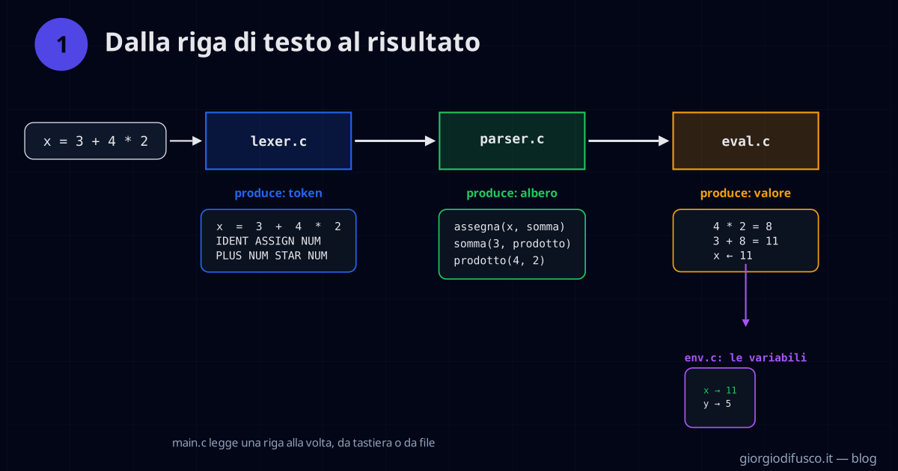
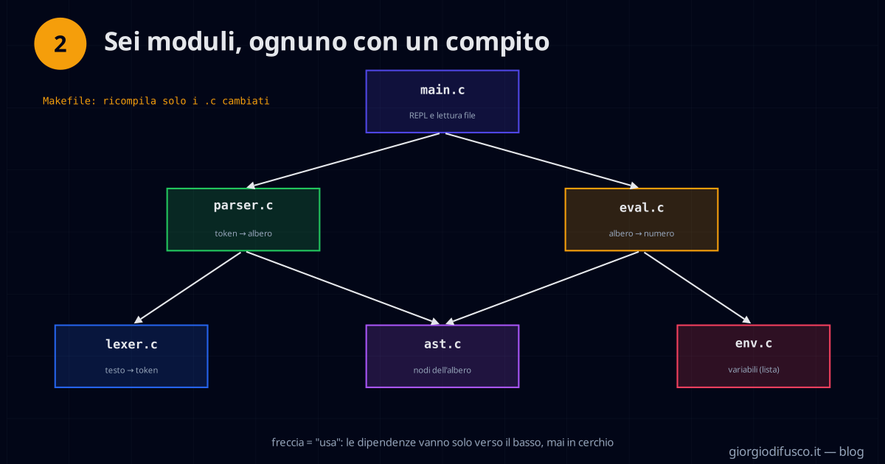
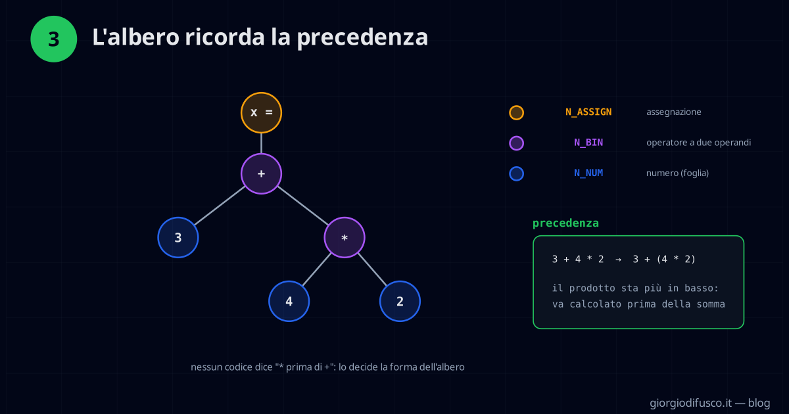
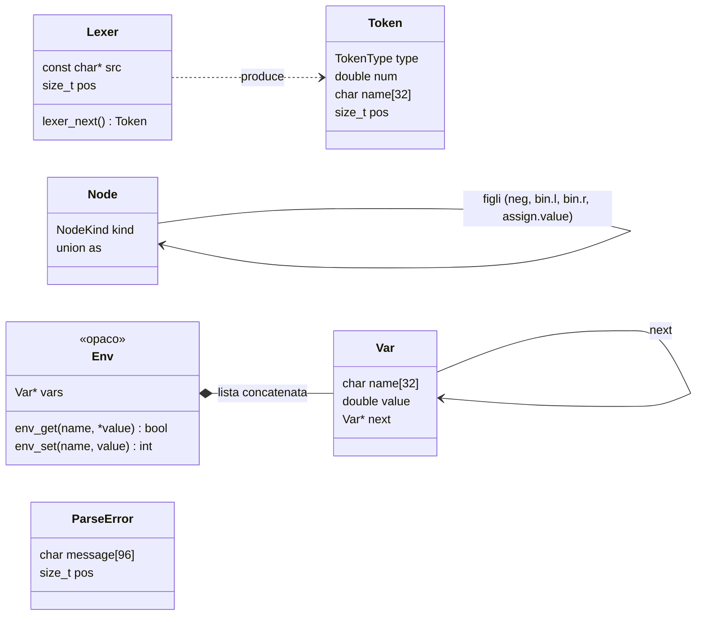
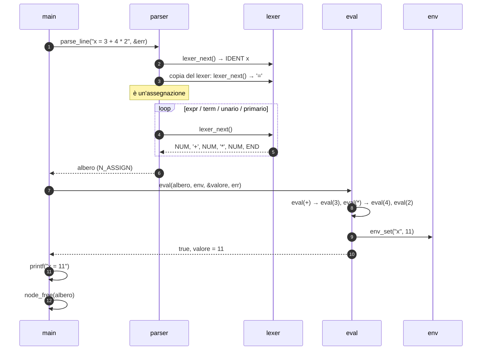
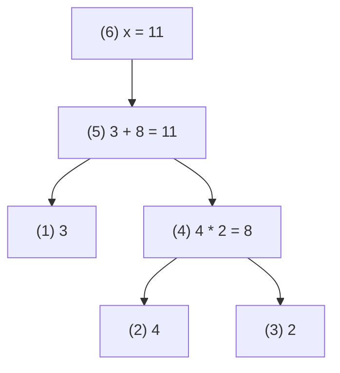
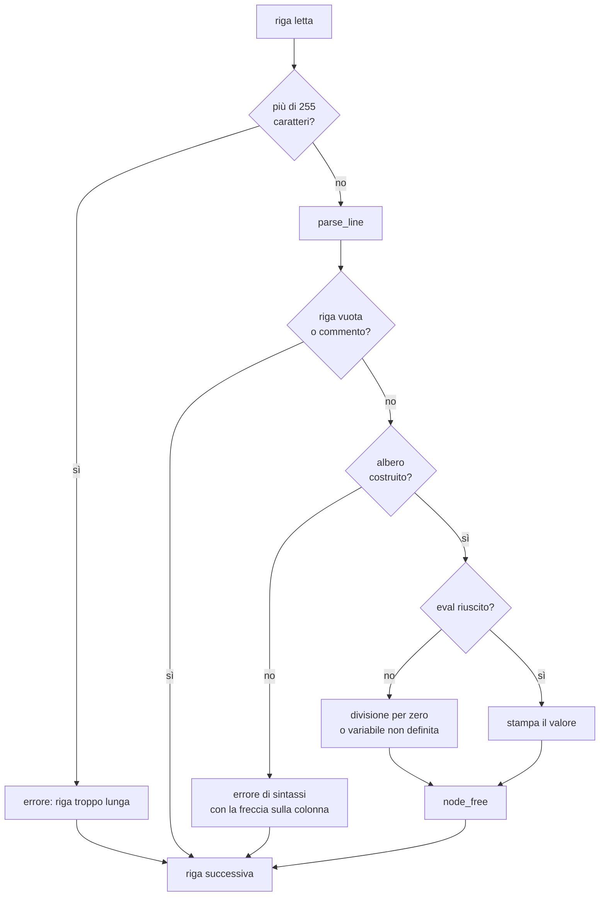

# Architettura di calc

Questo documento raccoglie gli schemi del progetto: le strutture dati, il percorso di una riga attraverso i moduli,
la gestione della memoria e degli errori. Per l'uso, vedi il [README](../README.md).

## Gli schemi dell'articolo

| Le tre fasi | I sei moduli | L'albero di `x = 3 + 4 * 2` |
|---|---|---|
|  |  |  |

## Le strutture dati

### Node: una tagged union

`kind` dice quale campo della union `as` è valido. Ogni tipo di nodo usa solo la sua parte:

| `kind` | Campo valido | Esempio | Figli |
|---|---|---|---|
| `N_NUM` | `as.num` | `3` | nessuno (foglia) |
| `N_VAR` | `as.name` | `x` | nessuno (foglia) |
| `N_NEG` | `as.neg.operand` | `-x` | 1 |
| `N_BIN` | `as.bin.op`, `as.bin.l`, `as.bin.r` | `a + b` | 2 |
| `N_ASSIGN` | `as.assign.name`, `as.assign.value` | `x = 1 + 2` | 1 |

`node_free` e `eval` sono entrambi uno `switch` su `kind` con un caso per riga della tabella.

### Env: un tipo opaco

`env.h` dichiara solo `typedef struct Env Env;`: fuori da `env.c` nessuno conosce i campi, quindi la lista concatenata
si potrebbe sostituire con una tabella hash senza toccare `main.c` né `eval.c`. Un nuovo nome viene inserito in testa
alla lista; assegnare un nome già esistente aggiorna il valore senza allocare.

## Il percorso di una riga

Che cosa succede quando l'utente scrive `x = 3 + 4 * 2`:

Il passo 3 è l'unico punto in cui il parser guarda avanti di un token: `x = ...` e `x + ...` iniziano allo stesso modo,
e solo il token successivo dice quale delle due regole di `riga` applicare. Il lexer è una semplice `struct`
(testo + posizione), quindi «guardare avanti» vuol dire copiarlo e chiamare `lexer_next` sulla copia.

### La valutazione dell'albero

`eval` visita l'albero in **post-ordine**: prima i figli, poi il nodo. I numeri tra parentesi sono l'ordine in cui
i nodi producono il loro valore:

## Errori

Gli errori non interrompono il programma: ogni riga sbagliata viene segnalata su `stderr` e si passa alla successiva.
Alla fine, se c'è stato almeno un errore, il codice d'uscita è 1.

Due regole tengono puliti i messaggi:

- **vale il primo errore.** Quando il parser fallisce, le funzioni che lo hanno chiamato falliscono a catena;
  `fail()` registra il messaggio solo se è ancora vuoto, così gli «echi» successivi non coprono la causa vera;
- **ogni errore ha una posizione.** Ogni token porta con sé la sua colonna (`pos`), e `main` la usa per disegnare
  la freccia `^` sotto la riga.

## Memoria

Ogni riga alloca il suo albero e lo libera prima di passare alla successiva; le variabili vivono nell'ambiente
fino alla fine del programma.

| Chi alloca | Che cosa | Chi libera |
|---|---|---|
| `parser.c` (`node_new`) | i nodi dell'albero di una riga | `main.c`, con `node_free` dopo `eval` |
| `parser.c`, se fallisce a metà | i sotto-alberi già costruiti | il parser stesso, prima di restituire `NULL` |
| `env.c` (`env_set`) | una `Var` per ogni nome nuovo | `env_free`, alla fine di `main` |
| `env.c` (`env_new`) | l'ambiente | `env_free` |

`make debug` compila con AddressSanitizer: `make debug && make test` esegue tutti gli esempi, compresi quelli con
errori a metà riga, senza perdite né accessi fuori dai blocchi.
